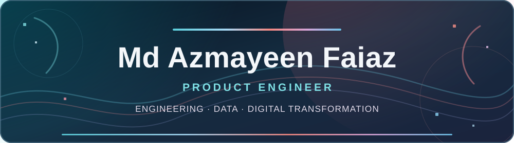

<!-- The first visible element is the live contribution animation. -->

  
  

**MSc in Digital Transformation Management (in progress)** &nbsp;·&nbsp; **BSc in Business Informatics**

*I craft intelligent, immersive digital experiences — connecting software engineering, expressive design, data, and product thinking.*

---

<strong>ENGINEERING &amp; TECHNICAL SKILLS</strong>

A spectrum of tools, technologies, and disciplines spanning product, engineering, and intelligence.

<strong>01 / Programming Languages</strong>

  
  
  
  
  
  

<strong>02 / Web, Mobile & APIs</strong>

  
  
  
  
  
  
  
  
  

<strong>03 / Data, Databases & Backend</strong>

  
  
  
  
  
  
  

<strong>04 / Intelligence Engines &amp; Blockchain</strong>

  
  
  
  

<strong>05 / Motion, UI & Creative Engineering</strong>

  
  
  
  
  

<strong>06 / Cloud, Deployment & Tools</strong>

  
  
  
  
  
  
  
  

<strong>07 / Analytics, Business & Systems</strong>

  
  
  
  
  
  
  
  
  
  
  

---

**MY APPROACH**

Product thinking &nbsp;·&nbsp; Intelligent systems &nbsp;·&nbsp; End-to-end engineering &nbsp;·&nbsp; Data-driven decisions

Engineering products where technology, intelligence, design, and business meet.

