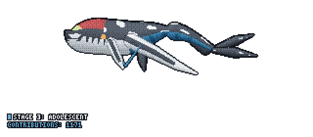

# Md Azmayeen Faiaz

### Product Engineer · Digital Transformation · Business Informatics

Building thoughtful digital products at the intersection of **software engineering, data, and business**.

---

### About me

I'm a **Product Engineer at Future Food Institute**, working across full-stack development, product engineering, and digital transformation. My background combines a foundation in business informatics with graduate studies in technology-driven management.

- **Current role:** Product Engineer · Future Food Institute, Italy
- **Master's:** MSc in Digital Transformation Management · **Alma Mater Studiorum – University of Bologna**, Italy *(in progress)*
- **Bachelor's:** BSc in Business Informatics · **University of Debrecen**, Hungary *(2025)*
- **Interests:** Software engineering, intelligent systems, data analytics, product development, and business technology

### Tech stack

**Programming & frontend**

**Backend, data & cloud**

**Business, analytics & systems**

---

### Education

| Degree | University | Period |
| :-- | :-- | :-- |
| **MSc · Digital Transformation Management** | University of Bologna, Italy | 2025 – Present |
| **BSc · Business Informatics** | University of Debrecen, Hungary | 2022 – 2025 |

---

### My GitHub contribution journey

An evolving visualization of my contributions, updated automatically.

